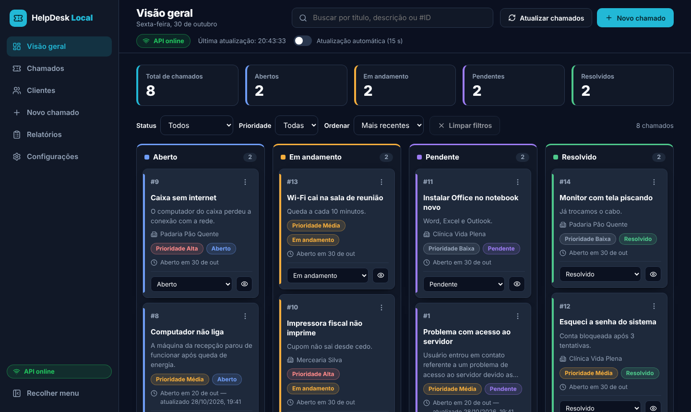

# Postman: apresentação e demonstração prática

Trabalho de faculdade sobre o **Postman**, ferramenta para testar, documentar e compartilhar APIs.
Para a demonstração ao vivo foi usado um sistema próprio, o **HelpDesk Local** (API em Django REST + tela em React), que serve de cenário para mostrar o Postman funcionando de verdade.

- **Autor:** Marcos Firmino Rodrigues
- **Curso:** Desenvolvimento de Software Multiplataforma (DSM), FATEC Araras



## O que este repositório contém

| Pasta | Conteúdo |
|---|---|
| `Slides_Postman/` | A apresentação sobre o Postman (PPTX e PDF, 18 slides) e as imagens usadas |
| `Postman/` | As coleções do Postman, prontas para importar |
| `chamados/`, `labticket/`, `manage.py` | A API do sistema de demonstração (Django REST Framework) |
| `frontend/` | A tela do sistema (React + Vite) |

## Sobre a apresentação

Os slides cobrem somente a ferramenta, sem explicar HTTP ou métodos:

1. O que é o Postman e como surgiu
2. Para que serve e qual a área de atuação
3. O que a ferramenta oferece: coleções, variáveis, testes, Collection Runner, mock servers, monitores, Newman e CLI
4. A documentação gerada pelo Postman e seus benefícios
5. Como usar no dia a dia
6. Quem usa
7. Outras ferramentas de teste de API (Insomnia, Bruno, Thunder Client, SoapUI, JMeter, k6) e as diferenças para o Postman
8. Demonstração ao vivo com o HelpDesk Local

Os números e as informações citadas têm a fonte indicada nos próprios slides. Alguns dados vêm da própria Postman.

## O que a demonstração mostra

A coleção `HelpDesk_Local_Cenario_Completo` tem **7 pastas, 67 requisições e 146 verificações automáticas**, todas passando no Collection Runner e no Newman. Ela mostra, na prática:

- o CRUD de chamados (GET, POST, PUT, DELETE) com a tela do sistema ao lado, atualizando em tempo real;
- testes automáticos em JavaScript em cada requisição;
- variáveis que guardam os IDs criados para as próximas requisições;
- filtros, busca, validações de erro (400, 404, 409) e testes de segurança;
- a documentação escrita dentro das pastas da coleção.

## Como reproduzir a demonstração

1. Rode a API e a tela (veja as seções abaixo).
2. No Postman, clique em **Import** e escolha `Postman/HelpDesk_Local_Cenario_Completo.postman_collection.json`.
3. Execute a pasta **1. Demonstração principal (CRUD)** requisição por requisição, ou use **Run collection** para rodar tudo.
4. Para rodar pelo terminal: `newman run Postman/HelpDesk_Local_Cenario_Completo.postman_collection.json`.

---

# Sistema de demonstração: HelpDesk Local

Sistema de chamados de suporte: **API em Django REST Framework** + **front-end em React (Vite)**.
O React consome a API real; nenhum dado é fixo no front-end.

## Tecnologias do projeto

- Back-end: Python, Django 5.2, Django REST Framework, django-cors-headers, SQLite
- Front-end: React 18, Vite 5, lucide-react (ícones), CSS puro com variáveis
- Testes de API: Postman (coleção incluída)

## Estrutura

```
helpdesk-local-postman/
├── manage.py
├── requirements.txt
├── labticket/                      # configurações do Django (settings, urls)
├── chamados/                       # app: models, serializers, views, testes
│   ├── models.py                   # Chamado, Cliente, Interacao
│   ├── templates/ + static/        # front-end simples antigo (http://127.0.0.1:8000/)
│   └── migrations/
├── frontend/                       # NOVO front-end React + Vite
│   ├── .env.example
│   └── src/ (components, hooks, services, utils, styles, config)
├── Postman/                        # coleções do Postman (importar no app)
└── Slides_Postman/                 # apresentação (PPTX e PDF) e imagens
```

## 1. Back-end (Django)

```powershell
# na pasta do projeto (onde está o manage.py)
python -m venv venv                 # só na primeira vez
venv\Scripts\activate
pip install -r requirements.txt
python manage.py migrate            # cria o banco db.sqlite3 vazio
python manage.py runserver
```

- API: http://127.0.0.1:8000/api/
- Admin: http://127.0.0.1:8000/admin/ (crie um usuário com `python manage.py createsuperuser`)
- Testes automatizados: `python manage.py test`

## 2. Front-end (React + Vite)

Requer Node.js 18 ou mais novo.

```powershell
cd frontend
copy .env.example .env              # opcional: só se quiser trocar o endereço da API
npm install
npm run dev
```

- Sistema: **http://127.0.0.1:5173/** (abra este endereço)
- O endereço da API fica em `frontend/src/config/api.js` e pode ser trocado em `frontend/.env`:
  `VITE_API_BASE_URL=http://127.0.0.1:8000/api`
- Build de produção: `npm run build` (gera `frontend/dist`).

## Endpoints

| Recurso | Rotas |
|---|---|
| Chamados | `GET/POST /api/chamados/` · `GET/PUT/PATCH/DELETE /api/chamados/{id}/` · `GET /api/chamados/resumo/` |
| Clientes | `GET/POST /api/clientes/` · `GET/PUT/PATCH/DELETE /api/clientes/{id}/` |
| Interações | `GET/POST /api/interacoes/` · `GET/PATCH/DELETE /api/interacoes/{id}/` (sem PUT) |

Filtros: `chamados?status=&prioridade=&cliente=&busca=` · `clientes?busca=&ativo=` · `interacoes?chamado=&tipo=`

Valores aceitos:

- **status**: `Aberto`, `Em andamento`, `Pendente`, `Resolvido`
- **prioridade**: `Baixa`, `Média`, `Alta`
- **tipo da interação**: `Observação`, `Atendimento`, `Alteração de status`, `Solução`

Regras:

- `Chamado.cliente` é opcional. Chamados antigos e os criados pelo Postman sem cliente continuam válidos.
- Cliente com chamados **não pode ser excluído** (a API responde `409 Conflict` com mensagem); marque-o como inativo.
- Excluir um chamado exclui também as interações dele.
- `Interacao.autor` é texto simples porque o projeto ainda não tem autenticação. Futuramente deve virar um relacionamento com o usuário autenticado.

Exemplo de criação de interação:

```json
{
  "chamado": 12,
  "mensagem": "Foi realizado o primeiro contato para validação do acesso.",
  "tipo": "Atendimento",
  "autor": "Equipe de suporte"
}
```

## Coleção do Postman

1. Importe `Postman/HelpDesk_Local_Cenario_Completo.postman_collection.json` (Import → arquivo). A coleção `HelpDesk_Local.postman_collection.json` é a versão simples.
2. A variável `base_url` já aponta para `http://127.0.0.1:8000`.
3. Os POSTs guardam automaticamente `id`, `cliente_id` e `interacao_id` para as requisições seguintes.
4. Cada requisição tem um teste simples com o código esperado: 200, 201, 204, 400, 404 (e 409 na exclusão de cliente com chamados).

## Roteiro da apresentação

1. Iniciar o Django (`python manage.py runserver`).
2. Iniciar o React (`npm run dev` dentro de `frontend`).
3. Abrir http://127.0.0.1:5173/.
4. Confirmar que o chamado de teste ainda não está na fila.
5. Abrir o Postman.
6. Enviar **Chamados → Criar chamado** (POST).
7. Confirmar `201 Created`.
8. Voltar ao sistema.
9. Clicar em **Atualizar chamados**.
10. Mostrar o chamado novo na coluna *Aberto* (com destaque de "Novo").
11. No Postman, enviar **Atualizar status (PATCH)** (`Resolvido`) ou o PUT.
12. Atualizar o sistema e mostrar o cartão na coluna *Resolvido*.
13. No Postman, enviar **Excluir chamado** (`204 No Content`).
14. Atualizar o sistema e mostrar que o cartão desapareceu.

## Como o front-end funciona

- `services/` concentra todas as chamadas HTTP (GET, POST, PUT, PATCH, DELETE); `204` não é convertido para JSON.
- O botão **Atualizar chamados** faz um novo `GET /api/chamados/`, mostra "Atualizando...", o horário da última sincronização e destaca cartões novos ou que mudaram de coluna.
- O indicador **API online / indisponível / verificando** depende de requisições reais à API.
- Arrastar um cartão para outra coluna envia um `PATCH`; se a API recusar, o cartão volta e aparece uma mensagem de erro.
- Erros de validação (`400`) devolvidos pela API aparecem ao lado dos campos.
- Excluir pede confirmação e só remove o cartão se a API responder com sucesso.

## CORS

O `CORS_ALLOW_ALL_ORIGINS = True` foi removido. Agora só `http://127.0.0.1:5173`, `http://localhost:5173` (Vite) e as mesmas portas `4173` (`npm run preview`) podem chamar a API pelo navegador. O Postman não é afetado por CORS. Para usar outro endereço de front-end, edite `CORS_ALLOWED_ORIGINS` em `labticket/settings.py`.

## Problemas comuns

| Problema | Solução |
|---|---|
| `can't open file 'manage.py'` | Entre na pasta do projeto (a que contém o `manage.py`). |
| `ModuleNotFoundError: No module named 'django'` | Ative o `venv` e rode `pip install -r requirements.txt`. |
| Erro de coluna inexistente (`prioridade`, `cliente`) | Rode `python manage.py migrate`. |
| Tela mostra "Não foi possível conectar à API." | O Django não está rodando, ou `VITE_API_BASE_URL` está errado. Inicie o Django e clique em "Tentar novamente". |
| Erro de CORS no console do navegador | Abra o sistema por `http://127.0.0.1:5173` ou `http://localhost:5173`, ou ajuste `CORS_ALLOWED_ORIGINS`. |
| `npm` não é reconhecido | Instale o Node.js (18+) e abra um novo terminal. |
| Porta 5173 em uso | Feche o outro Vite (a porta é fixa para combinar com o CORS). |
